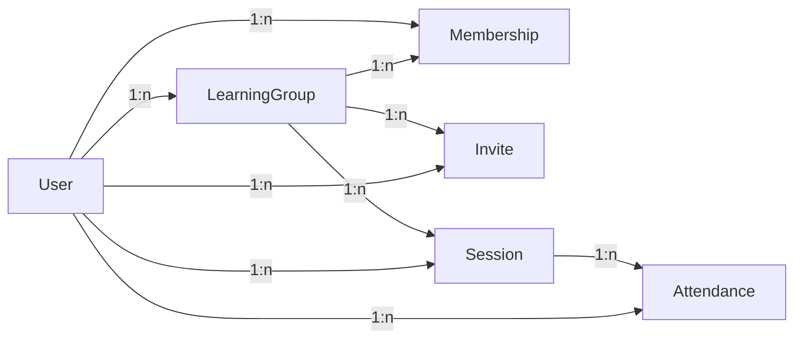

# SyncSession

Terminfindung für Lerngruppen: Mitglieder schlagen Termine vor, sagen zu oder ab
(auch nur für einen Teil-Zeitraum), und der Kalender zeigt den gemeinsamen Konsens an.

## Start

```bash
./start.sh          # installiert requirements, migriert die DB, startet auf Port 6767
```

Datenbank: SQLite (`SyncSession/db.sqlite3`), Migrations liegen in den Apps.

## Aufbau

Drei Django-Apps:

- **accounts** — nutzt das Standard-`User`-Modell von Django (kein eigenes), plus Profil-Seite und Homescreen mit den nächsten Terminen.
- **lerngruppen** — `LearningGroup`, `Membership` (M2M zwischen User und Gruppe) und `Invite` (Einladungslinks mit Token, 48 h gültig).
- **kalender** — `Session` (Terminvorschlag oder geblockte Zeit) und `Attendance` (Zusage/Absage eines Mitglieds, optional mit Teil-Zeitraum). Liefert außerdem einen öffentlichen ICS-Feed pro Gruppe (`/abo/<token>.ics`) und den Polling-Endpunkt `/gruppen/<pk>/termine/status/`, über den das Frontend alle 5 s prüft, ob sich etwas geändert hat.

## Datenmodell



- **User** — Standard-`User` von Django (kein eigenes Model in `accounts`).
- **LearningGroup** — Lerngruppe mit Name, Ersteller, Einladungs-`calendar_token` (ICS-Abo) und `members_can_invite`.
- **Membership** — M2M zwischen User und Gruppe, unique pro Paar, mit `joined_at`.
- **Invite** — Einladungslink mit unique Token, Ersteller und Ablauf (`expires_at`, 48 h).
- **Session** — Termin der Gruppe: Titel, Ort, Start/Ende (`end > start`), `kind`, `display_override`, Ersteller, `created_at`/`updated_at`.
- **Attendance** — Zusage/Absage eines Users zu einer Session, unique pro Paar; bei `zugesagt` mit Teil-Zeitraum (`start`/`end`).

## Kernkonzepte

- **Session.kind**: `vorschlag` (Terminvorschlag, mit Zusagen) oder `blockiert` (geblockte Zeit, z. B. Vorlesung — ohne Zusage, optional wöchentlich wiederholt).
- **Consensus**: Sagen alle anderen Mitglieder zu, wird der Schnitt ihrer Zeiträume grün hervorgehoben (`session-konsens`); sagen alle ab, wird der Termin durchgestrichen (`session-abgesagt`).
- **Attendance**: `zugesagt` mit `start`/`end` (Teil-Zeitraum möglich), `abgesagt` ohne Zeiten. Unique pro `(session, user)`; `updated_at` treibt das Autosync-Polling an.
- **display_override**: Bei gemischten Rückmeldungen (Zusagen und Absagen) kann der Ersteller festlegen, ob der Termin als „angenommen" oder „abgesagt" dargestellt wird.
- **Constraints**: `Session.end > start`; bei `Attendance` müssen Zeiten genau bei `zugesagt` gesetzt sein; `Membership` und `Attendance` jeweils unique pro Paar.
- **Sichtbarkeit**: Nur Mitglieder einer Gruppe sehen deren Kalender (`_member_or_403`); der ICS-Feed ist über den geheimen `calendar_token` öffentlich.
